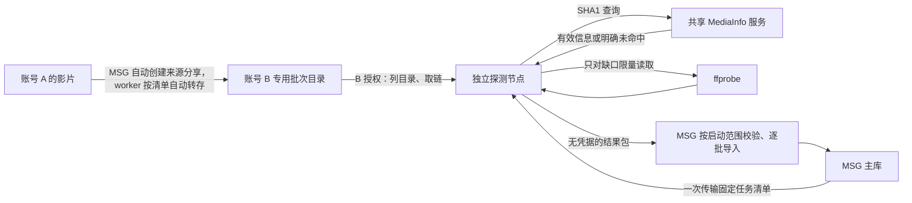

# 第二账号与独立节点的全库文件信息补齐方案

日期：2026-10-26，自动转存修订于 2026-10-27。状态：本地实现已接入按库启动的自动编排、B 自动转存和逐批回填；使用方式见[worker 使用说明](secondary-account-media-probe-worker.md)。尚未部署或执行真实云盘任务。

## 1. 结论与范围

采用“主账号 A 提供文件来源 → 账号 B 云端转存 → 独立节点复用信息、按需 probe → MSG 校验回填”的路线。B 必须先拥有对应文件的云端副本，随后使用 B 自己的授权、文件标识和直链读取。只把 A 的直链交给另一台服务器，不能实现账号隔离。

目标覆盖全库，先补时长、分辨率、音视频编码，再补容器、帧率、HDR、位深、声道、采样率及有可靠来源的码率。未知字段明确保留未知，不编造编码或码率。首版对应现有 `media` 字段；完整多音轨、字幕轨道目录需要另行扩展模型。

这条路线隔离生产凭据、探测负载和出口；无法据此量化 115 风控概率，也不保证账号之间完全不受关联影响。提速主要依靠复用、共享库命中、相同内容去重及避免重复失败读取，而不是提高并发。

用户已授权本地实现与模拟验证；尚未授权真实登录轮询、转存、目录遍历、取链、probe、删除或生产写回。

## 2. 已有依据

本会话 2026-10-26 的只读快照：

| 项目 | 结果及含义 |
| --- | --- |
| 媒体记录 | 13,619 条，均为云端媒体 |
| 缺少基础技术字段 | 11,897 条；正式执行前重新用数据库计算 |
| 基础字段齐全但缺总码率 | 292 条，作为后续补齐范围 |
| 当前可用于共享库查询的文件 SHA1 | 未持久化；不能直接进行真实样本命中率测试 |
| `media.file_hash` | 现有查重用途，不能冒充 115 文件 SHA1 |
| 已有技术信息来源 | 播放后异步探测和显式文件信息队列；成功结果写入同一个 `media` |

现有队列还检查探测版本，因此排队数量不等于缺字段数量。新计划先审查字段缺口；仅版本旧、字段已齐全的记录应先做本地校验，不为版本标记单独发起网络探测。

当前共享服务只验证过公共测试请求可访问，真实库命中率仍未知。不能按片名、TMDB ID 或“同一部电影”复用不同版本文件的技术信息。

## 3. 拓扑与职责

- A 的密码、Cookie、Token 和直链均不交给探测节点。A 仅参与启动范围内的身份核验与创建来源分享阶段，不能把整个流程描述成 A 完全没有云盘操作。
- B 的令牌只由一个探测服务管理刷新，不同时交给多个 OpenList/worker 刷新。
- 探测节点不能直连生产数据库；通过服务密钥保护的 API 接收一次任务清单与后续有限批次，返回结果包；不接收 A 凭据。
- `media` 继续是技术信息的唯一业务来源。节点上的检查点文件只保存任务进度、内容缓存和证据，播放器不读取它；首版采用受限、原子写入的 JSON，无独立数据库服务。
- 候选节点为环境文档中的 GreenCloud `192.131.142.137`。尚未验证当前可用性、资源和公网出口；部署前核对。华为云 `115.175.67.229` 目前承担生产 OpenList 出口，不用作独立探测节点。
- 节点的 115 控制接口与媒体读取均走该节点的固定出口，不复用生产代理，不自动切换账号或出口。

主机依据：[当前生产环境入口](../../docs/current-production-environment.md)。后续实现和镜像验证遵守[服务器中心工作流](../../docs/server-centric-workflow.md)。

## 4. 前置阶段：文件转存到 B

### 4.1 按批转存，不要求一次复制整库

先由 MSG 数据库导出缺口清单、文件字节数、目录分布；此步骤不访问 115。MSG 从现有入库配置匹配所选库根，使用既有 A 登录自动创建来源分享；B 节点自动创建专用暂存父目录。worker 使用现有分享清单/转存协议，只转存缺口清单选中文件。来源链接与提取码只在加密任务检查点及 B 节点私密文件中保存，公开计划只保存来源摘要。用户不处理这些配置。

worker 沿来源相对路径定位文件，为每个文件创建确定名称的 B 暂存子目录，不合并同名文件。只提交该文件的来源 ID，转存后核对文件名、字节数和 SHA1，并记录两端文件 ID；不把成功响应直接当作映射完成。转存是在云端完成的文件保存流程，不要求服务器下载完整影片；速度、容量占用和限制以实际账号结果为准。

建目录与转存先持久化写入意图。请求结果不明时停止；新批准计划恢复时只读取核对，不重复提交。已确认副本重新核对身份，不再次转存。整库批次范围固定；自动模式启动时一次批准整个有限任务的文件数、总请求/流量预算和最长时间，无需逐批确认。离线工具仍只执行单个批准批次。

流程为：转存一批 → 验证映射 → 补齐 → 导入并核验 → 再安排下一批。容量充足时可以扩大批次，但不会因为账号已登录就自动启动整库操作。

B 的副本默认保留。若需要滚动释放容量，另行预览并批准删除；只能精确列出本任务创建且已完成回填的 B 文件 ID，不按名称、目录通配或相似文件清理，不清空回收站，也不触碰 A 原文件。

### 4.2 文件映射必须能够追溯

任务清单记录 `media_id`、库内相对路径、文件名、字节数、现有技术字段及来源指纹。B 清单记录批次、父目录、B 文件 ID、PickCode、SHA1、字节数及相对路径，凭据和直链不落入清单。

两端文件 ID、PickCode 不相同，不能相互替代。路径、名称、大小只能筛选候选，不能单独证明文件内容相同。

自动转存使用用户确认的来源映射，逐项核对来源相对路径与字节数，随后核对 B 副本 SHA1；原始路径不要求在 B 物理重建，用来源别名和转存证明保持对应。出现重名、缺文件、尺寸/哈希变化或来源不明时停止。已有副本模式仍要求独立目录中的原样批次，没有可靠对应证据不自动写回 A。

从导出到回填期间，来源批次应保持不改名、不替换。若 A 云端文件已被同路径、同大小的另一文件替换而 MSG 尚未同步，仅靠 MSG 快照无法发现；来源稳定性不能确认时不自动导入，不能把离线指纹描述为对 A 当前内容的实时校验。

必须先用小批验证能否建立上述对应关系。若分享、转存功能不可用或无法证明对应关系，当前路线在此处停止，不自动改成下载 A 的完整文件或使用 A 的直链。

## 5. 补齐流水线

1. **只读导出全库计划。** 任务固定到一份快照；每条记录列明需要的字段。已有完整信息不重复 probe。
2. **按批准范围列 B 的批次目录。** 普通目录响应已经包含文件 SHA1、大小和 PickCode，一次保存这些字段，不逐文件追加搜索获取 SHA1，也不下载文件计算整文件哈希。只遍历已授权批次，分页持久化进度；预算耗尽即暂停。
3. **映射并按 `SHA1 + 字节数` 去重。** 多个已经证明来源一致的媒体记录可指向同一内容结果。SHA1 单独存为带算法和来源的内容身份，不能复用 `file_hash`。
4. **复用已确认同文件的信息。** 先使用主库快照中已有且验证通过的技术字段；无法证明同文件的不复用。
5. **查询共享 MediaInfo。** 只发送 SHA1，不发送文件名、路径、115 凭据或分享链接。返回 SHA1、大小和媒体结构必须验证；大小要求字节级相等。服务超时、缺项、解压失败、数据冲突与明确未命中分开记录。服务异常不自动把整批降级成 probe；有效数据缺字段时，只把仍缺字段的内容列入探测计划。
6. **只探测已确认缺口。** 用 B 的 PickCode、B 的 Token 和固定 UA 获取 B 的直链；读取也使用相同 UA。获取直链后核对返回内容身份，单次 ffprobe，不调用 ffmpeg 二次兜底，不刷新目录找替代文件，不取 A 的直链。
7. **导出结果包。** 包含清单 ID、内容身份、映射证据、技术字段、来源、工具版本、实际请求/流量、状态及错误。直链仅在内存短期使用，原始日志与结果包不包含 Token、Cookie 或带签名 URL。
8. **MSG 导入预览与写回。** 核对媒体 ID、来源指纹、大小及当前字段变化，展示将补齐、冲突、部分信息未知和失败的数量。实际导入复用现有解析、持久化及缓存失效路径，不从节点直接执行 SQL。

共享服务返回的数据属于外部输入，需要限制响应大小和解压后大小、校验类型和合理范围。首版只查询，不向共享服务上传用户的媒体信息。

导入只补快照中缺失且当前仍缺失的字段。已有字段与外部结果明显矛盾时记录冲突，不覆盖。源文件或字段在导出后变化时重新比较，不能用旧结果覆盖播放刚补齐的信息。导入应幂等，并保存所改字段的前后值供审核和精确撤销。

有用但不完整的结果可以回填；状态仍为“部分信息未知”。基础必需字段不齐时不能仅设置探测版本而标记成功。总码率可按现有规则由文件大小和时长推算，并在报告标为估算；不拆算音频、视频码率。ISO/BDMV 等不在首版常规文件探测能力内的对象单独报告。

## 6. 请求、流量和停止边界

所有数值是待验证的工程预算，不是 115 官方安全阈值。登录授权、转存、列目录、取链及媒体 Range 读取分别统计；第二账号仍会产生真实 115/CDN 请求。

首个运行试验建议为五个媒体库各选 2 条、最多 10 条，验证自动转存和映射。下面保留最初“已有副本”的候选预算；新增自动转存模板总控制请求上限 80 次、15 分钟（含身份、分享清单、建目录、转存、B 核验），详见使用说明。两种模式的真实运行均尚未获准：

| 控制项 | 候选上限 |
| --- | --- |
| B 目录分页 | 最多 20 次真实请求，仅批准目录；到限停止，不扩大遍历 |
| B 文件取链 | 最多 10 次；共享命中或本地复用会减少次数 |
| 账号核验、令牌刷新 | 各最多 1 次；全部计入总量 |
| 115 控制请求总量 | 最多 32 次，不包含另行统计的用户授权、分享和转存阶段 |
| 115 控制请求间隔、并发 | 至少 5 秒，并发 1 |
| 媒体读取 | 每文件最多 6 次上游 HTTP 请求，含 HEAD、Range、重定向；全轮最多 60 次，相邻请求至少 1 秒 |
| 媒体读取字节数 | 每文件最多 32 MiB，全轮最多 320 MiB |
| probe | 并发 1，单文件最长 30 秒，上一文件结束后至少等 10 秒 |
| 全轮时间 | 最长 10 分钟，到限暂停，未处理项保留 |
| 共享查询 | 最多 1 次，最多 10 个去重 SHA1，失败不重试 |
| OpenList refresh、自动转存、自动删除 | 均不执行 |

实施前必须根据最终清单再次报告目标、接口类别、请求上限、频率、并发、时间、真实 115/refresh 情况以及账号和链路风险，并取得明确执行许可。登录与转存阶段的调用范围不能偷偷算作免费前置步骤。

具体实现要求：

- 在 HTTP 出口计数和拦截真实请求，包括 SDK 刷新、重放、重定向。SDK 现有鉴权失败后的自动刷新和重放不能直接沿用；适配层禁用该路径，刷新由一个明确、计费到预算的入口负责。
- ffprobe 仅收到节点内的受控读取入口地址，由入口转发到 B 的直链并限制上游请求数与所读取的响应体字节。协议、容器白名单排除 HLS、DASH、播放清单等可派生外链的输入；首版不提供进程级网络沙箱。`probesize` 和 `analyzeduration` 不作为 HTTP 总流量上限。响应体预算不包含 TCP/TLS、HTTP 头及传输层预读开销。
- 达到任一预算先停止新请求并中断当前读取；取消、进程退出、服务重启均不自动继续执行。断点保存进度，继续运行需要新的明确范围。
- 首轮遇任一错误即暂停后续任务。正式规则中，鉴权失败、403/405/429、平台风控或刷新频控业务码必须全局暂停，不自动重试、切账号、换 IP 或扩大读取预算。
- 令牌正常到期只允许在已批准预算内由唯一管理者刷新，原子保存新令牌；不能通过反复登录解决过期问题。
- 不把目录的 `refresh=false` 当作零真实请求承诺。首版 worker 不经过生产 OpenList，避免其隐藏恢复、缓存失效和重试链路。

全库规模应在小批结果后再定。设需要补齐的去重内容数为 U、可复用或共享命中数为 H，则候选 probe 数为 `U - H`；还要单列无法映射、服务失败和不支持的对象。目录请求按每个目录的实际页数累加，不能用全库文件数除以单页容量代替。

仅以 11,897 条均为不同内容的保守口径举例：

| 复用和共享有效命中率 | 尚需 probe 的内容约数 |
| --- | --- |
| 0% | 11,897 |
| 50% | 5,949 |
| 90% | 1,190 |

串行且每文件结束后等 10 秒时，11,897 次 probe 的间隔本身就约 33 小时，另加探测、列目录和转存时间。因此不能承诺一晚完成，也不能在没有命中率数据时称第二账号会让整库显著提速。

## 7. 账号 B 的登录信息如何交付

**使用现成开放平台授权流程，用户自己完成官方登录和授权；自动转存另需 B 的 Cookie，不在聊天中传密码、验证码、Cookie 或 Token。**

1. 实施登录阶段时先提供授权入口和本机私密文件模板。按 [OpenList 的 115 Open 授权说明](https://doc.oplist.org/guide/drivers/115_open)选择合法可用的应用参数，由用户在跳转到的 115 官方页面确认当前登录的是 B，再完成授权。扫码或浏览器登录方式以官方页面实际提供的选项为准。
2. 授权成功后，用户将 B 的 Access Token、Refresh Token 和 Cookie 写入工作区之外的私密文件，例如 `C:\Users\28263\.codex\secrets\115-probe-b.json`；限制 ACL。运行时分别核验 Token 与 Cookie 的实际身份一致。来源分享另存私密文件，仅摘要进入计划。现在不创建真实凭据。
3. 用户只在聊天里提供文件路径。后续经授权的部署步骤直接读取文件，经 SSH 写入探测机的专用 secret 文件，不打印内容，不经过 Git、命令行参数或普通日志。
4. 服务端目录权限 `0700`、凭据文件 `0600`，仅专用服务用户及系统管理员可读，凭据挂载与结果包分开；一个服务实例负责刷新。成功核验 B 身份后只输出脱敏账号标识，不顺便遍历媒体库。
5. 本机凭据文件是否删除由用户决定。服务端凭据的撤销可在 115 设备/应用授权管理中完成；撤销后任务应暂停并明确报告授权失效。

若 B 已经在其他服务中使用同一份令牌，先确定唯一刷新归属，不能复制后让两个实例竞争刷新。OpenList 文档还说明同账号、同应用重复获取 Refresh Token 有数量限制，因此不能反复授权当作重试策略。

2026-10-27 已补齐[管理页面的 B 独立授权](secondary-account-media-probe-campaign.md)：使用公开 OpenList 应用 ID `100197303`，网页扫码与设备码 PKCE 分两次确认；节点核验两项实际身份后原子保存。授权轮询固定为最多 48 次请求、每阶段 20 次状态查询、串行间隔至少 5 秒、总时长 5 分钟，须在页面确认范围和风险后才启动。当前只有本地模拟验证，未验证真实扫码协议响应；不因登录成功自动启动媒体探测。

## 8. 实现边界、验证与交付

后续代码集中在现有 MSG 开发工作区内，使用一个 worker 入口和 MSG 导入入口。复用 `ProbeResult`、探测 JSON 解析器、`persistMediaProbeResult` 及缓存失效逻辑；新增必要的字段级导入校验和来源指纹检查，不复制另一套媒体数据库和写回业务。现有显式队列已有“不使用 ffmpeg 二次读取”的策略可复用，不能直接启动生产的待处理队列代替 B 任务。

建议按以下阶段交付：

1. **离线实现和验证。** 用脱敏数据及模拟 HTTP 服务验证映射冲突、重复结果、过期快照、字段合并、部分结果、取消、请求/流量硬上限及凭据脱敏。此阶段真实 115 请求为 0。
2. **登录与来源配置。** 管理员确认节点身份和独立出口，用户在管理页面完成 B 两次扫码并选择媒体库；A 库根分享及 B 暂存目录由系统按批准的固定计划准备，先核对容量和可行性。
3. **批准范围内的小批测量。** 先共享查询，再按清单补缺，报告映射成功率、共享原始/有效命中率、基础字段补齐率、各类真实请求数、读取字节数、耗时和失败原因。
4. **MSG 导入预览。** 使用结果包验证对应关系和字段变化；生产实际写回及所需发布另行明确，不把节点成功当作生产变更已获授权。
5. **按批扩展到全库。** 按剩余数量、B 容量、试验耗时和实际请求成本生成有限执行计划。每批覆盖哪些记录、上限和结束条件均固定，不自动变成无限后台扫描。

所有部署基于已提交并推送的精确 SHA 和不可变镜像，节点只拉取运行。完整结果报告要让全库每条记录都有可解释状态：已补齐、部分未知、映射冲突、不支持、失败或尚未执行；不能把跳过或失败算作补齐成功。

## 9. 核对过的实现与外部资料

- [现有文件信息队列](media-probe-queue.md)、[探测结果持久化](../internal/service/media_probe_result.go)、[ffprobe 与显式队列策略](../internal/service/ffprobe.go)。
- [115 SDK 目录字段与取链](https://github.com/OpenListTeam/115-sdk-go/blob/v0.2.4/fs.go)：目录条目包含 SHA1、字节数、PickCode，可避免逐文件搜索获取哈希。
- [115 SDK 的刷新和重放行为](https://github.com/OpenListTeam/115-sdk-go/blob/v0.2.4/request.go)：使用前必须适配请求预算及暂停规则。
- [共享 MediaInfo 查询协议](https://github.com/DDSRem-Dev/p115center-sdk/blob/master/p115center/client.py)：SHA1 批量查询；本方案使用更严格的大小校验，不照搬其宽松校验及自动重试。
- [OpenList 授权与令牌说明](https://doc.oplist.org/guide/drivers/115_open)、[SDK 设备码授权能力](https://github.com/OpenListTeam/115-sdk-go/blob/v0.2.4/auth.go)。
